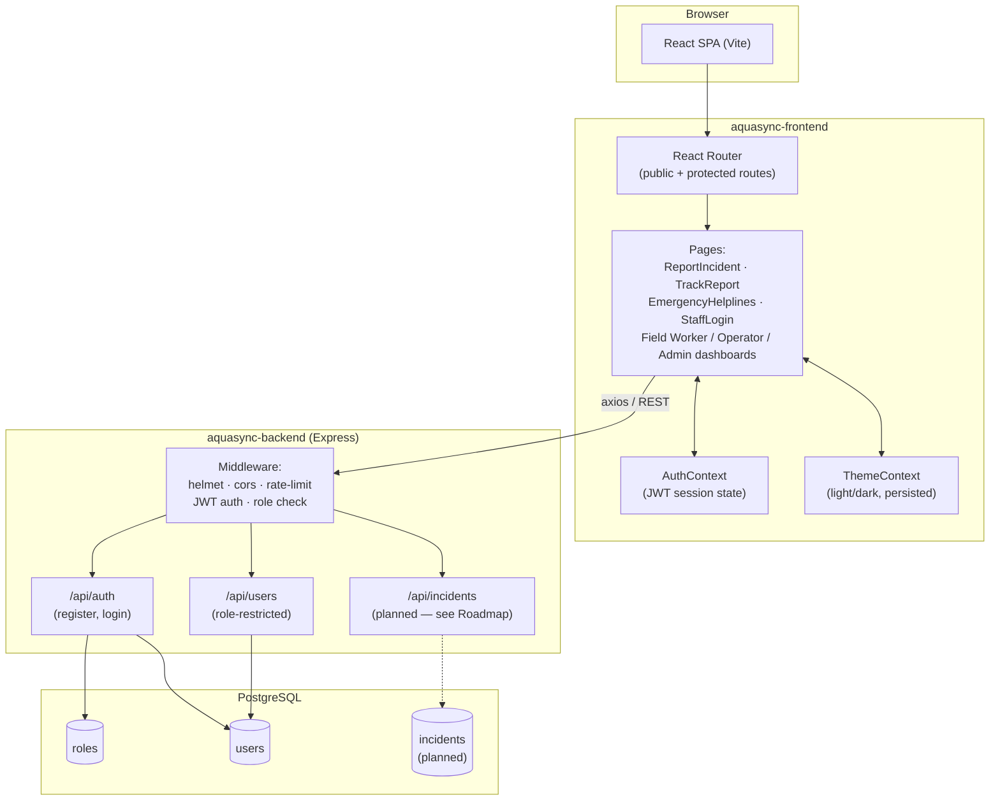

# AquaSync

**AquaSync is a citizen incident-reporting and emergency-response platform.**
Citizens report water/infrastructure emergencies with zero friction (no login,
no account), and staff — field workers, operators, and admins — triage,
assign, and resolve those reports through role-restricted dashboards.

> Long-term vision: evolve into a broader urban resilience platform
> (weather/infrastructure monitoring, risk prediction, response coordination).
> See [Roadmap](#roadmap) for what's built vs. planned.

---

## Core Principle

**Citizens never log in.** The public, unauthenticated flow is the primary
product surface — someone reporting an emergency shouldn't have to create an
account to do it. Only staff sign in, and only to reach their dashboard.

---

## Architecture



**Request flow for a citizen report (once the incidents API is built):**

```
Citizen fills out form on "/"
      → POST /api/incidents (public, no token, rate-limited)
      → backend writes row to `incidents` table, generates a reference code
      → citizen can check status anytime at /track/:referenceCode

Operator logs in → sees full incident queue → assigns to a field worker
      → field worker updates status → citizen's /track page reflects it
```

---

## Tech Stack

| Layer | Technology |
|---|---|
| Frontend framework | React 18 + Vite |
| Routing | React Router v6 |
| Styling | Tailwind CSS, CSS-variable-based theming (light/dark via `.dark` class) |
| HTTP client | axios |
| Backend framework | Node.js + Express |
| Database | PostgreSQL (`pg`) |
| Auth | JWT (`jsonwebtoken`) + `bcrypt` password hashing |
| Backend security | `helmet`, `cors`, `express-rate-limit` |
| Hosting (recommended) | Vercel (frontend) · Render (backend + Postgres) |

---

## Project Structure

```
aquasync/
├── aquasync-frontend/
│   ├── src/
│   │   ├── api/                  → axios instances / API call wrappers
│   │   ├── components/
│   │   │   ├── Navbar.jsx
│   │   │   ├── ProtectedRoute.jsx
│   │   │   └── ThemeToggle.jsx
│   │   ├── context/
│   │   │   ├── AuthContext.jsx
│   │   │   └── ThemeContext.jsx
│   │   ├── pages/
│   │   │   ├── ReportIncident.jsx     → public, "/"
│   │   │   ├── TrackReport.jsx        → public, "/track"
│   │   │   ├── EmergencyHelplines.jsx → public, "/helplines"
│   │   │   ├── StaffLogin.jsx
│   │   │   ├── Unauthorized.jsx
│   │   │   ├── NotFound.jsx
│   │   │   └── dashboards/
│   │   │       ├── FieldWorkerDashboard.jsx
│   │   │       ├── OperatorDashboard.jsx
│   │   │       └── AdminDashboard.jsx
│   │   ├── App.jsx                → route definitions
│   │   ├── main.jsx               → provider tree (Router > Theme > Auth > App)
│   │   ├── index.css              → Tailwind layers + theme tokens
│   │   └── App.css
│   ├── tailwind.config.js
│   ├── vite.config.js
│   └── package.json
│
└── aquasync-backend/
    ├── db/
    │   └── schema.sql             → roles + users tables, seeded roles
    ├── src/
    │   ├── config/db.js           → PostgreSQL connection pool
    │   ├── controllers/
    │   │   └── authController.js  → register/login logic
    │   ├── middleware/
    │   │   ├── authMiddleware.js  → JWT check + role check
    │   │   └── errorHandler.js
    │   ├── routes/
    │   │   ├── authRoutes.js
    │   │   └── userRoutes.js
    │   └── server.js              → app entrypoint
    ├── .env.example
    └── package.json
```

---

## Routes (Frontend)

| Route | Access | Notes |
|---|---|---|
| `/` | Public | Report an incident — no account needed |
| `/track`, `/track/:referenceCode` | Public | Check status by reference code |
| `/helplines` | Public | National emergency helpline numbers + nearest hospital/pharmacy/police locator |
| `/staff/login` | Public | Staff sign-in |
| `/staff/field-worker` | `field_worker` role | Assigned reports, status updates |
| `/staff/operator` | `operator` role | Full incident queue, assign to field workers |
| `/staff/admin` | `admin` role | Stats, staff account management |

---

## API Endpoints (Backend)

**Live today:**
- `POST /api/auth/register`
- `POST /api/auth/login`
- `GET /api/users/me` — any authenticated user
- `GET /api/users?role=field_worker` — operator, populates assign dropdown
- `GET /api/users` — admin, full staff list

**Planned (not yet implemented — see Roadmap):**
- `POST /api/incidents` — public, no auth. `{ issueType, location, description, severity, contactPhone, latitude, longitude }` → returns `{ referenceCode, ...incident }`
- `GET /api/incidents/track/:referenceCode` — public
- `GET /api/incidents` — operator/admin, list all
- `GET /api/incidents/assigned-to-me` — field_worker
- `PATCH /api/incidents/:id/assign` — operator/admin. `{ fieldWorkerId }`
- `PATCH /api/incidents/:id/status` — field_worker/operator/admin. `{ status }`
- `GET /api/incidents/stats` — admin. `{ open, inProgress, resolvedThisWeek, avgResponseTime }`

---

## Features

**Implemented:**
- ✅ Public, no-login incident report form
- ✅ Public status tracking by reference code
- ✅ Role-based staff auth (JWT + RBAC: field_worker / operator / admin)
- ✅ Protected dashboard routing per role
- ✅ Light/dark theme, persisted across sessions, respects system preference on first visit
- ✅ Emergency Helplines page — national numbers (Police, Fire, Ambulance, Women's/Child helplines, Disaster Management, Cyber Crime) + geolocation-based "find nearest hospital/pharmacy/police station" via Google Maps

**Roadmap:**
- ⬜ `incidents` table + full CRUD API (reports currently have nowhere to persist)
- ⬜ Admin analytics dashboard (active/resolved counts, avg response time)
- ⬜ SMS/email notifications on status change
- ⬜ Sensor simulation layer (`sensors`, `sensor_readings` tables)
- ⬜ Interactive city risk map
- ⬜ Rule-based or ML risk prediction
- ⬜ Citizen photo uploads for incident reports
- ⬜ Incident history / recurring-problem-area analytics

---

## Getting Started

### Backend
```bash
cd aquasync-backend
npm install
cp .env.example .env       # fill in DATABASE_URL and JWT_SECRET
psql -U postgres -d aquasync -f db/schema.sql
npm run dev                 # runs on http://localhost:5000
```

### Frontend
```bash
cd aquasync-frontend
npm install
cp .env.example .env        # set VITE_API_URL to your backend URL
npm run dev                 # runs on http://localhost:5173
```

---

## Deployment

- **Frontend** → Vercel (root directory: `aquasync-frontend`, build: `npm run build`, output: `dist`)
- **Backend** → Render Web Service (root directory: `aquasync-backend`, build: `npm install`, start: `npm start`)
- **Database** → Render PostgreSQL (free tier), connection string passed to backend as `DATABASE_URL`

Set `VITE_API_URL` in the frontend's environment to point at the deployed
backend URL, and ensure the backend's CORS config allows the deployed
frontend origin.

---

## Security Notes

- `.env` files are gitignored on both frontend and backend — never commit real secrets.
- `POST /api/incidents` (once built) must stay public and unauthenticated by
  design, so make sure rate-limiting is applied specifically to that route to
  prevent spam/abuse.
- Passwords are hashed with `bcrypt`; JWT secret should be a long random value
  (see backend README for a one-liner to generate one).
